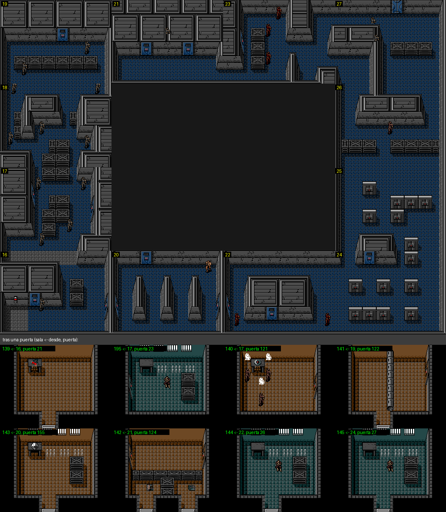
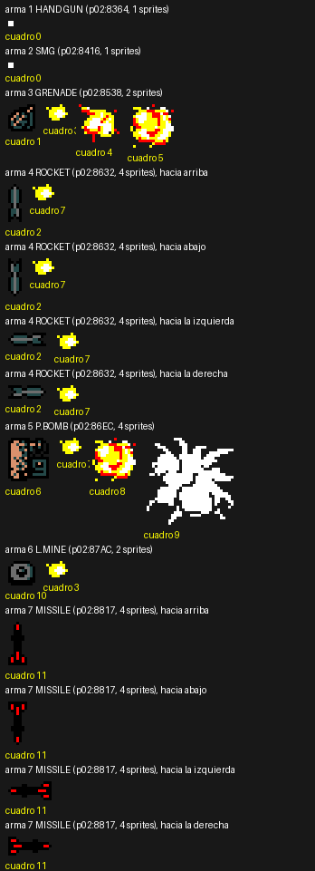
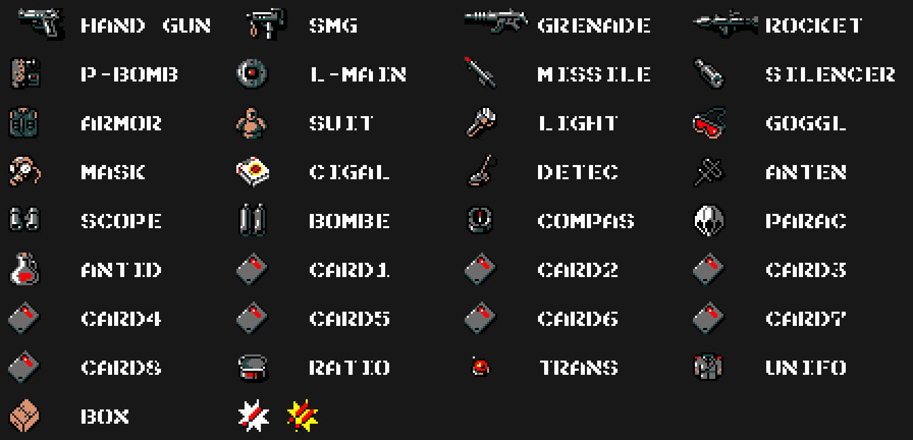
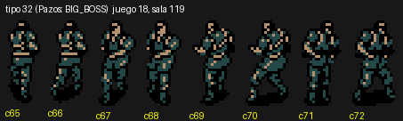
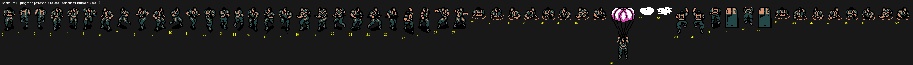
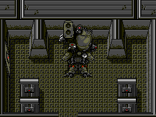
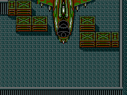
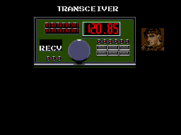
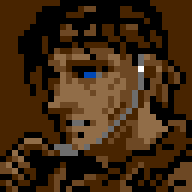

# The game

*Metal Gear* (Konami, 1987, RC-750) is the first game of the saga, for the
MSX2. Snake goes into Outer Heaven alone and unarmed, and has to reach Metal
Gear. Everything on this page comes from the cartridge's tables.

## Rooms and zones

The room index (`p13:6000`) has 251 entries, 16 of which are not rooms (their
pointer falls in the nibble table): that leaves **235 rooms**. Each room is
6 × 8 metatiles of 4 × 4 tiles (`p13:61F6`, `p13:6274`), from one of 8 tile
sets.

Rooms are joined in two ways:

- **by their sides**: each room with neighbours has four in `p05:8E0E`, in
  the order up, down, left and right (`p01:63FC` decides which side you leave
  by);
- **by doors**: `p15:A7C0` gives, room by room, 5-byte records
  [door][type][Y][X][target room]. There are **154 numbered doors**, and each
  appears in both rooms it joins.

Following the neighbours gives **9 zones**. The rooms reached only through a
door go in a strip under their zone's map.

The maps of the nine zones, full size:
[0](imagenes/zona_00.png), [1](imagenes/zona_01.png),
[2](imagenes/zona_02.png), [3](imagenes/zona_03.png),
[4](imagenes/zona_04.png), [5](imagenes/zona_05.png),
[6](imagenes/zona_06.png), [7](imagenes/zona_07.png),
[8](imagenes/zona_08.png).

## Lifts

Rooms 0xF0 to 0xFA are lifts. `p05:8DA8` gives their stops; the car stops at
heights 0x38, 0x78 and 0xB8 (`p09:AD69`). F8 and F9 have no stops.

## Doors

The door type decides how it is drawn (`p01:773C`): types 1 to 5 are tiles
from page 1, 6 is the lift and 7 to 19 are bank 15 drawings. The class
(`p15:B046`) decides how it opens (`p01:78F4`): facing it, with the card
selected (classes 2 to 9 = CARD1 to CARD8), with punches, with the P.BOMB or
with a flag set by a text.

## Weapons and items

Eight weapons (`p06:B865`): HAND GUN, SMG, GRENADE, ROCKET, P.BOMB, L.MINE,
MISSILE and SILENCER. Twenty-five items (`p06:B8F6`): ARMOR, SUIT, LIGHT,
GOGGL, MASK, CIGAL, DETEC, ANTEN, SCOPE, BOMBE, COMPAS, PARAC, ANTID, CARD1 to
CARD8, RATIO, TRANS, UNIFO and BOX. What each adds when picked up is at
`p05:8AE8`; the ammunition and ration maximums depend on the CLASS
(`p02:9101`).

Each weapon and each item has its drawing in page 1 of the VRAM (`p06:B855`
the weapons, `p06:B8C0` the items); the equipment window copies it with its
name (`p00:47A6`), written here with the game's font as the ROM stores it
(weapon 6 reads "L-MAIN", `p06:B898`). The eight cards share one drawing. At
the end, the two alerts shown over the soldier who sees Snake (`p02:98B5`):
"!", or "!!" if `0xC614` is not zero, and then reinforcements arrive every
0x1E frames.

## Actors

64 actor types. Each has its number of sprites (`p05:971B`), its colours
(`p05:975A`), its stamina (`p05:984F`), its hit box per weapon (`p05:8951`,
`p05:8992`) and its damage per weapon (`p05:87B7`). Their 143 frames are at
`p05:9890`, and their patterns in 31 sprite sets (`p10:6185`, `p10:6280`).
The type names quoted are Manuel Pazos's.

Snake has 53 poses (`p10:6000`) in patterns 0x00-0x37; the room's start at
0x38.

## The tile bosses

Metal Gear and the Hind D are not sprites: they are bank 15 tile drawings
(`p15:B595`, `p15:B431`) that `p00:44AF` puts over the room.

Metal Gear only breaks with the P.BOMB and with the 16 hits in the order of
`p02:8D3B`. After that a countdown from 3000 runs, and the ending is reached
by leaving room 0xE2 at the top.

## The transceiver

Seven frequencies, from 120.13 to 120.91 (`p00:490C`). Each room's calls are
at `p15:B6C6`; the one that plays is the one on the tuned frequency that
passes the conditions at `p01:6A88`.

There is a single portrait, Snake's (`p09:ABA1`): the others have no face. It
only moves its mouth with texts 0x0A (his SEND) and 0x9B: with each letter,
one every 4 frames, it picks one of three drawings from the frame count
(`p00:5E17`: `p15:B425`, `p15:B42B` or the closed mouth `p15:B41F`).

